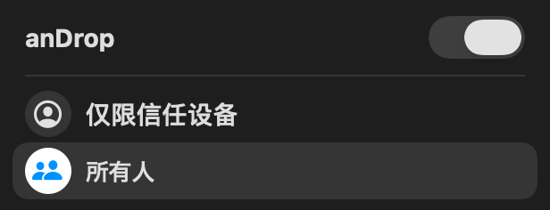
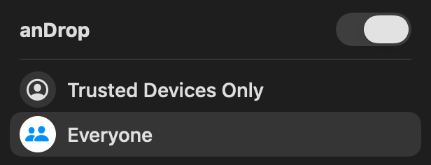

# 接收面板原型

简体中文 · [English](README.en.md)

保留将来复用，**不含正常构建／安装包**。现应用无控制中心项，接收范围用菜单栏／设置。

## 预览

macOS仓库根目录、备构建文档Swift工具链：

```sh
python3 Prototypes/ReceivePanel/preview.py
python3 Prototypes/ReceivePanel/preview.py --english
```

独立预览只用内存虚构状态，开关／范围可交互，不启动anDrop/蓝牙/文件/历史/设置写入或退出安装版。Escape退出，默认中文，--english英语。

| 中文（虚构） | 英语（虚构） |
| --- | --- |
|  |  |

截图示SwiftUI布局，实时加native glass并跟系统外观，不证明传输。

## 保留内容与复用

ReceiveControlsView.swift独立开关/范围bindings、SF Symbols/native switch/整行选择/hover/高对比；makeReceiveControlsContent在26+用NSGlassEffectView、旧系统标准popover。原尺寸308pt宽、42头、32行、26图标圆、16外角；英中，选中随系统accent。

复用时switch绑定真实radio/host，范围绑定信任政策（旧关闭会退出host），radiosAvailable可禁开关，dismiss连host panel。保留未知仍能发现Mac但请求拒绝提示。

旧WidgetKit/App Intents/presentation App Group/host集成在Git95e72ee；Apple Controls API不能把自定义panel嵌入系统控制中心，旧项只打开独立host panel。恢复需刻意构建/签名/注册，本原型不注册。原创源码/截图GPL-3.0-only，SF Symbols仅在UI渲染、不独立分发。
