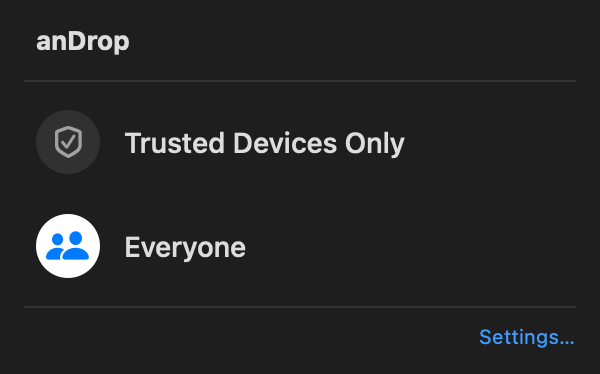

# anDrop

**Send files between your Mac and a phone or tablet using its built-in compatible sharing feature.**

[简体中文](README.md) · English

anDrop is a macOS menu bar app for the **互传联盟 (Mutual Transfer Alliance)** ecosystem. No prior connection to a vendor desktop app, extra phone app, account, cloud service or USB cable is needed at runtime. **Both devices still need Bluetooth enabled and the same local Wi-Fi network.**

> **Development version 0.1.1. No ready-to-download installer is available yet.** For now, [build from source](#build-from-source). An OPPO phone has been tested in both directions; one OPPO tablet has been tested sending to the Mac. Other brands and models remain untested. The mock screens below do not establish compatibility with every brand shown.

## See how it works

These images use the actual app views with fictional device names, filenames, Computer Name and progress. They contain no real accounts, device records or transferred content.

### 1. Choose a device and send

Select files in Finder, then **Share → anDrop**. A small badge identifies the phone or tablet beside its circular brand logo. Click a device to send; click the pencil to give it a name stored only on this Mac.


### 2. Follow progress and keep working

A blue ring and percentage show sending progress. Preparing, waiting for acceptance and connecting have their own states. The app says “Sent” only after the other device confirms completion.


Clicking another window during sending moves anDrop into the background while the transfer continues. You can also close the popup and reopen progress from the menu bar. After a successful send, clicking outside dismisses it.

### 3. Set it up your way

Received files go directly into **Downloads** by default. The menu bar provides Send Files, progress, recent transfers and Settings; no main window needs to stay open.

<details>
<summary>View Settings (mock data)</summary>


</details>

## Get started

### Before your first transfer

- Use a Mac running anDrop and a phone or tablet with a **compatible Mutual Transfer Alliance sharing feature**.
- Enable Bluetooth on both and join the same local Wi-Fi network. Guest networks or networks that isolate devices may prevent transfers.
- On first launch, allow Bluetooth, Local Network, notifications and destination-folder access when needed. Receiving is enabled whenever anDrop is running. Quit anDrop to stop receiving.

### Mac → phone or tablet

1. Open sharing on the receiving device and allow nearby devices to discover it. You may need to temporarily choose “Everyone”; some systems turn this off after a few minutes.
2. Select files in Finder → **Share → anDrop**, or use **Send Files** in anDrop’s menu bar.
3. Choose the device and approve the incoming files on it.

### Phone or tablet → Mac

1. Select files on the device, open its built-in compatible sharing feature and choose the Mac.
2. Accept in anDrop’s notification or menu bar. Every incoming transfer requires approval.
3. Find the files directly in Downloads. Existing files are preserved by adding a number to duplicate names; received files are not opened automatically.

One transfer runs at a time. Compress folders first. Send files with identical base names in separate transfers.

## Common questions

| What happened? | What to try |
| --- | --- |
| anDrop is missing from Finder’s Share menu | Open anDrop once, then enable its Share extension in macOS settings. You can also send from the menu bar. |
| The Mac cannot find the phone or tablet | Unlock the receiving device, reopen sharing and enable everyone-visible mode. Check the same Wi-Fi; visibility can expire automatically. |
| A device stays listed briefly after becoming undiscoverable | It normally disappears about 10–11 seconds after its last Bluetooth advertisement. The Mac cannot read the other system’s visibility countdown. |
| Two devices show the same person’s name | Sharing names may come from an account. Use the phone/tablet badge and pencil to name each device locally. For identical entries, initially make only one discoverable. |
| No notification appears | Check macOS notification and Focus settings. Approval and progress are also available in the menu bar. |
| The phone cannot find the Mac while Petal is running | Coexistence is experimental. Finish Petal transfers before trying anDrop’s manual repair in Settings, which restarts Petal. If needed, quit Petal while receiving. |

Names and privacy: local device names allow **40 characters** and do not rename the phone or account. The Mac uses its system Computer Name by default. Click the pencil beside the nearby name in Settings to set a custom sharing name (up to 15 UTF-8 bytes); leave it blank to restore the default. This does not rename your Mac. Nearby advertisements allow **15 UTF-8 bytes**—15 ASCII characters or typically 5 Chinese characters—while transfer confirmations use the full name. Nearby devices can see the advertised name. Transfer history stays on this Mac and can be cleared in Settings. While Petal runs, anDrop temporarily uses `A` nearby and keeps a Dock icon to improve coexistence.

## Receive scope and trusted devices

Choose **Trusted Devices Only** or **Everyone** in the menu bar or Settings. Every transfer still requires approval in both modes; trusting a device never enables automatic acceptance.

Open Settings → **Trusted Devices…** to add devices from previous transfers even when they are offline. New devices need one transfer in Everyone mode first. Device rows use manufacturer artwork with a phone/tablet badge. Verify the requesting device yourself. Different local identifier suffixes distinguish devices with identical names. Remove trust or forget a remembered device at any time.

This filter uses Bluetooth identifiers remembered by this Mac, not account or device names. It is not cryptographic pairing or authenticated identity. Add a device again if its identifier changes. Nearby advertisements remain visible. Trusted-only mode rejects unlisted requests before showing approval or connecting over Wi-Fi to download files. Removing trust does not interrupt an already-started transfer.


## Control Center (macOS 26 and later)

Open anDrop, then choose Control Center → **Edit Controls** and search for **anDrop**. Add the single **anDrop** control. It opens a compact panel with anDrop and its receive switch in the header, followed by Trusted Devices Only / Everyone. Turning the switch off quits the app. Opening the control starts the app without opening its main Settings window. If Bluetooth or Wi-Fi is unavailable, the switch shows off; enable the radios in macOS Control Center. Public Controls API does not allow a third-party app to embed an AirDrop-style detail panel inside Control Center itself, so this panel opens near the menu bar. If an older Toggle Sharing tile remains after an update, remove that obsolete tile in Edit Controls. This feature uses [Apple’s official Controls API](https://developer.apple.com/documentation/widgetkit/controls-collection).

Set the control to **Medium** size to show the selected receive scope (Trusted Devices Only / Everyone), or **Off** when anDrop is closed or its radios are unavailable. The small size shows only the symbol. The native control follows the system accent color and appearance. Clicking it opens receiving options; use the switch in that panel to quit. The control uses a native toggle as a state indicator and resynchronizes after opening the panel, so its appearance may briefly change during the click. macOS controls the active tile background; it does not exactly reproduce Apple’s AirDrop module.



## Which devices work?

The Mutual Transfer Alliance is a cross-brand ecosystem used by manufacturers including Xiaomi, HONOR, OPPO and vivo. **It is separate from Google Quick Share and is not an Android-wide standard.** See [HONOR’s official overview](https://www.honor.com/cn/support/content/zh-cn15883773/). Compatibility depends on model, region and software version. Alliance membership or a displayed logo does not mean that anDrop has been tested with that device.

| Device or feature | Current status |
| --- | --- |
| OPPO Find X9 Pro | Physical same-Wi-Fi transfers verified in both directions, with matching file hashes. |
| One OPPO tablet | Discovery, tablet identification and tablet → Mac verified; Mac → that tablet untested. |
| Xiaomi, HONOR, vivo and other brands/models | Compatible devices in the target ecosystem; not physically tested yet. |
| Apple Silicon Mac, macOS 27.0.1 | Tested development environment. Intel and earlier macOS versions are untested. The declared macOS 14 minimum is not a tested support range. |
| Petal Interconnect coexistence | Experimental. Transfers have succeeded, but discovery conflicts can recur. |
| Wi-Fi Direct, Google Quick Share, Huawei Share | Not implemented. HarmonyOS devices are untested. |

See the [compatibility matrix](docs/compatibility.md) and [test report](docs/testing.md). Recognizing a brand or device category does not identify the exact model.

## Build from source

For developers and users comfortable installing build tools. **There is no one-click installer in this repository yet.** If you are unfamiliar with the terminal, you can review the usage and compatibility information above and wait for a future packaged release.

You need macOS, Xcode 26 or later (including the macOS 26 SDK and App Intents tools), Swift 6.2+ and Python 3.14. The recorded environment used Apple Silicon, macOS 27.0.1, Swift 6.4 and Python 3.14.7.

After downloading or cloning this repository, run these commands in its directory:

```sh
python3.14 -m venv .venv
.venv/bin/python -m pip install -r requirements.txt
.venv/bin/python build.py
```

The output is `build/anDrop.app`. Quit an older copy, put the app in Applications and open it. Builds are ad-hoc signed by default; notarization is not automated. Use macOS’s normal opening and permission flow; disabling system security features is not required. See [building, signing and installation](docs/building.md).

<details>
<summary>Developers: tests, architecture and documentation images</summary>

```sh
.venv/bin/python -m unittest discover -s tests -v
swift test
python3 scripts/render-docs.py
```

- [Architecture and protocol boundaries](docs/architecture.md): Bluetooth discovery and negotiation, with files using the existing local network.
- [Detailed usage and troubleshooting](docs/usage.md): discovery expiry, aliases, progress, Petal and receive errors.
- [Device identification](docs/device-identification.md): evidence and limits of brand/category detection.
- [Documentation image generation](docs/images/README.md): reproducible production views with fictional data on a Mac.
- `Sources/`: native host, Finder extension and transfer engine; `tests/`: related checks.

The repository is named **cn-android-share**; the app is named **anDrop**.

</details>

## License and affiliation

Project-authored source, documentation and app icon assets use **GPL-3.0-only**. Third-party components retain their own licenses. [Official brand artwork](Resources/BrandLogos/README.md) retains its owners’ copyright and trademark rights and is excluded from this project’s GPL grant, including logos visible in documentation images. See [LICENSE](LICENSE), [NOTICE.md](NOTICE.md) and [licensing details](docs/licensing.md).

This project is not affiliated with, certified by or endorsed by device manufacturers or Apple. Documentation images use fictional data only. Real device logs, private screenshots, vendor APKs, decompiled vendor source, credentials and signing material are excluded from the repository.
