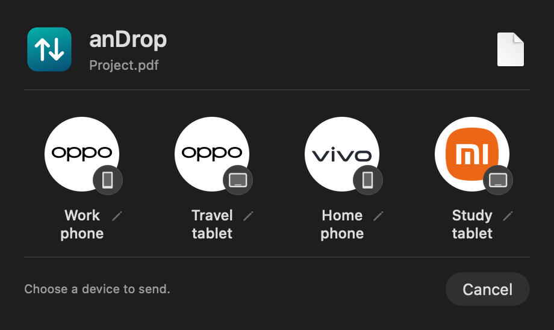
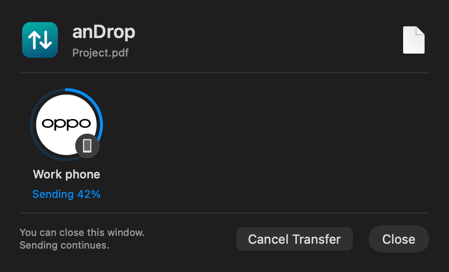
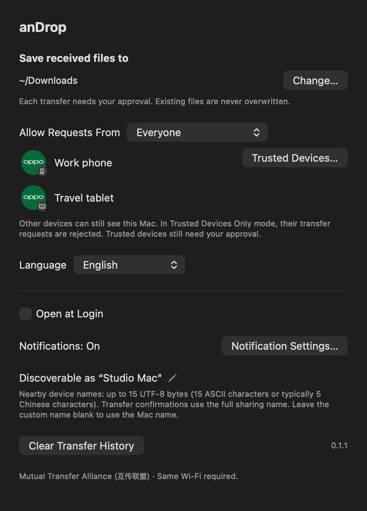
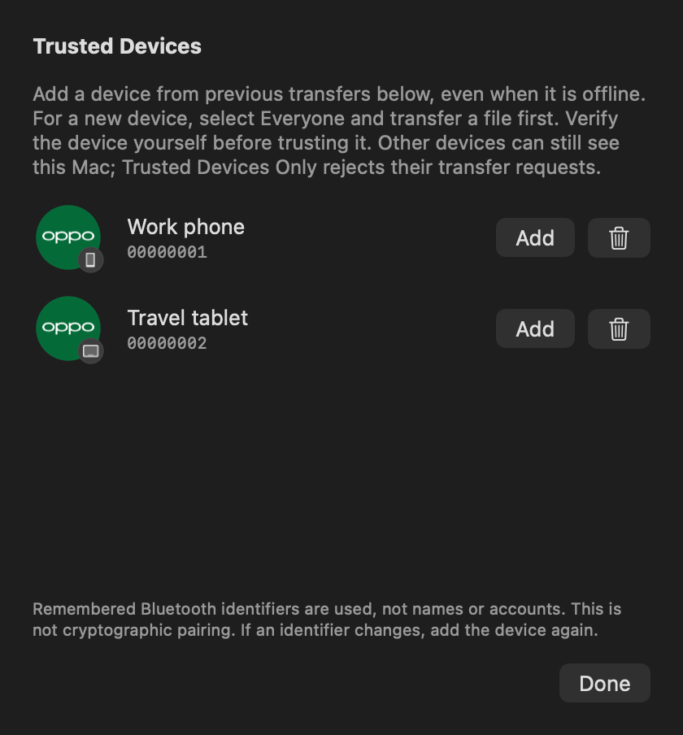

# anDrop

**Send files between your Mac and a phone or tablet using its built-in compatible sharing feature.**

[简体中文](README.md) · English

anDrop is a macOS menu bar app for the **互传联盟 (Mutual Transfer Alliance)** ecosystem. No prior connection to a vendor desktop app, extra phone app, account or USB cable is needed. File transfers stay on the local network. **Both devices need Bluetooth enabled and the same local Wi-Fi network.**

**[Download anDrop](https://github.com/TakeruF/cn-android-share/releases/latest)** · [Usage and troubleshooting](docs/usage.md) · [Compatibility](docs/compatibility.md)

Version 1.0.0 provides a DMG for **Apple Silicon Macs running macOS 14 or later**. An OPPO phone has been tested in both directions; one OPPO tablet has been tested sending to the Mac. Other brands and models remain untested. Build checks enforce the minimum OS for bundled binaries, but macOS 14 has not been tested on a physical Mac. Mock images do not establish compatibility with every brand shown.

The main branch includes **1.0.1 connection and trusted-device fixes**, which have not yet been released as a new installer. The download above is still 1.0.0. See the [test record](docs/testing.md) for verified scenarios and limitations.

## Install and get started

1. Download the `.dmg`, open it and drag **anDrop** into **Applications**.
2. Open anDrop and allow Bluetooth, Local Network, notifications and destination-folder access as needed. A paper-plane icon appears in the menu bar.
3. Enable compatible sharing on the other device and connect both devices to the same local Wi-Fi. Guest networks or networks that isolate devices may prevent transfers.

Fresh installations default to **Simplified Chinese**. Choose English or System Default in Settings; an existing language choice is preserved. Receiving is enabled while anDrop is running; quit to stop receiving. No main window needs to stay open. The Dock icon normally stays hidden; it remains visible while Petal runs to improve Bluetooth discovery.

## See how it works

These are production app views with fictional device names, filenames, Computer Name and progress. They contain no real accounts, device records or transferred content.

### Mac → phone or tablet

Enable sharing and nearby visibility on the receiving device. You may need to temporarily select Everyone; some systems automatically expire this mode after a few minutes.

Select files in Finder, then **Share → anDrop**, or choose **Send Files** in the menu bar. A badge beside the manufacturer logo distinguishes phones and tablets. Click a device to send, then approve receipt on that device. The pencil beside its name sets a name stored only on this Mac.



The progress ring and percentage show sending progress. Preparing, waiting and connecting have separate states. Sent appears only after the recipient confirms completion. Clicking another window moves anDrop into the background while sending continues.



Before sending, Cancel dismisses the picker. While sending, it cancels the transfer. After a successful send, clicking outside dismisses the popup.

### Phone or tablet → Mac

1. Select files on the device, open its built-in compatible sharing feature and choose the Mac.
2. Accept in anDrop’s notification or menu bar. **Every incoming transfer requires approval.**
3. Files go directly into **Downloads** by default. Duplicate names receive a numeric suffix; existing files are never overwritten and received files are not opened automatically.

One transfer runs at a time. Compress folders first. Send files with identical base names in separate transfers.

### Settings

Change the destination folder, sharing name, language, Open at Login, receiving scope and update settings. License and GitHub links are at the bottom.

<details>
<summary>View Settings (mock data)</summary>



</details>

## Receive scope and trusted devices

Choose **Trusted Devices Only** or **Everyone** in the menu bar or Settings. Both modes require approval for every incoming transfer.

**This differs from AirDrop Contacts Only: untrusted devices may still see this Mac. Trusted Devices Only rejects their transfer requests; it does not hide anDrop.** See [discovery limits and receive filtering](docs/trusted-discovery.md).

In Settings → **Trusted Devices…**, add devices from successful incoming transfers even when they are offline. New devices must first send a file to this Mac in Everyone mode. Rows show manufacturer artwork, a phone/tablet badge and a device name. Local identifier suffixes distinguish identical names. Remove trust or forget a device at any time.



The filter stores a hash of the protocol sender ID, so rotating Bluetooth addresses do not remove trust. Names and accounts do not authorize receipt. This is a self-reported ID, not cryptographic pairing or authenticated identity. After the control connection supplies the ID, unlisted senders are rejected before approval and before downloading files. Listed senders still require approval. Removing trust does not interrupt an already accepted transfer. Old UUID-only entries require one incoming transfer in Everyone mode and enrollment of the new record; matching a display name is not a safe migration.

## Automatic updates

**Automatic checks and automatic downloads are enabled by default.** anDrop checks GitHub Releases at launch and periodically afterward. Once an update is downloaded and its signatures are verified, it prompts you to restart and install. Choose Later to install when you quit. Checks or restarts are deferred during transfers.

Disable automatic checks or downloads in Settings → Updates, or check manually from the menu bar. Updating needs access to GitHub; file sharing does not use a cloud service.

## Common questions

| What happened? | What to try |
| --- | --- |
| anDrop is missing from Finder’s Share menu | Open anDrop once and enable its Share extension in macOS settings, or send from the menu bar. |
| The Mac cannot find a device | Unlock it, reopen sharing, enable Everyone visibility and check the Wi-Fi. Visibility may have expired. |
| A device remains listed briefly after becoming undiscoverable | It normally disappears about 10–11 seconds after its last Bluetooth advertisement. The Mac cannot read the other system’s visibility countdown. |
| Two devices show the same person’s name | Sharing names can come from an account. Use the badge and pencil to name each device locally. For identical entries, initially make only one discoverable. |
| No notification appears | Check macOS notification and Focus settings. Approval and progress are also available in the menu bar. |
| Discovery fails while Petal runs | Coexistence is experimental. Finish Petal transfers before using the manual repair in Settings, which restarts Petal. If needed, quit Petal while receiving. |
| Finder’s Share menu still shows the old icon | macOS may retain the old extension icon in its cache. Restart the Mac later; this does not prevent file transfers. |

Names and privacy: local device aliases allow **40 characters** and do not rename the phone or account. The Mac uses its system Computer Name by default; change the sharing name with the pencil in Settings, or leave it blank to restore the default. Nearby names allow **15 UTF-8 bytes** (15 ASCII characters or typically 5 Chinese characters); transfer confirmations use the full sharing name. Nearby devices can see the advertised name. History stays on this Mac and can be cleared in Settings. While Petal runs, the nearby name temporarily becomes `A`.

## Which devices work?

The Mutual Transfer Alliance is a cross-brand ecosystem used by Xiaomi, HONOR, OPPO, vivo and other manufacturers. **It is separate from Google Quick Share and is not an Android-wide standard.** See [HONOR’s official overview](https://www.honor.com/cn/support/content/zh-cn15883773/). Compatibility depends on model, region and software version. Alliance membership or a displayed logo does not establish anDrop compatibility.

| Device or feature | Current status |
| --- | --- |
| OPPO Find X9 Pro | Physical same-Wi-Fi transfers verified in both directions, with matching hashes. |
| One OPPO tablet | Discovery, tablet identification and tablet → Mac verified. Mac → that tablet untested. |
| Xiaomi, HONOR, vivo and other brands/models | Compatible devices in the target ecosystem; not physically tested yet. |
| Apple Silicon Mac, macOS 27.0.1 | Tested development environment. Release targets macOS 14+. Physical macOS 14 and Intel testing remain outstanding; no Intel installer is provided in 1.0.0. |
| Petal Interconnect coexistence | Experimental. Transfers have succeeded, but discovery conflicts can recur. |
| Wi-Fi Direct, Google Quick Share, Huawei Share | Not implemented. HarmonyOS devices untested. |

Physical transfer results come from development testing, not a fresh test after every UI or packaging change. See [compatibility](docs/compatibility.md) and [validation records](docs/testing.md). Brand/category recognition does not identify the exact model.

## Build from source

Most users should download the DMG. Developers need Xcode 26 or later, Swift 6.2+ and Python 3.14. **Use Python and dependencies built for older macOS versions**, such as the official python.org installer. A local Homebrew Python may require a newer OS. The build checks every bundled Mach-O binary against the declared minimum.

```sh
python3.14 -m venv .venv
.venv/bin/python -m pip install --only-binary=:all: -r requirements.txt
.venv/bin/python build.py
```

Output: `build/anDrop.app`. Local builds are ad-hoc signed by default; release builds use Developer ID. The build fetches a pinned, checksum-verified Sparkle framework. See [building, signing and releases](docs/building.md). Disabling macOS security features is not required.

<details>
<summary>Developers: tests, architecture and documentation images</summary>

```sh
.venv/bin/python -m unittest discover -s tests -v
swift test
python3 scripts/render-docs.py
```

- [Architecture and protocol boundaries](docs/architecture.md)
- [Detailed usage and troubleshooting](docs/usage.md)
- [Device identification](docs/device-identification.md)
- [Documentation image generation](docs/images/README.md)
- [Archived receive-panel prototype](Prototypes/ReceivePanel/README.md): source and standalone preview of the removed Control Center panel, excluded from release builds.

The repository is named **cn-android-share**; the app is named **anDrop**.

</details>

## License and affiliation

Project-authored source, documentation and app icons use **GPL-3.0-only**. Dependencies retain their own licenses. [Official manufacturer artwork](Resources/BrandLogos/README.md) retains its owners’ copyright and trademark rights and is excluded from the GPL grant, including artwork visible in documentation images. See [LICENSE](LICENSE), [NOTICE.md](NOTICE.md) and [licensing details](docs/licensing.md).

The project is not affiliated with, certified by or endorsed by manufacturers or Apple. Documentation images contain fictional data only. Real device logs, private screenshots, vendor APKs, decompiled vendor source, credentials and private keys are excluded. Developer ID certificates are inspectable and identify their signer; anonymous source metadata does not hide that identity.
