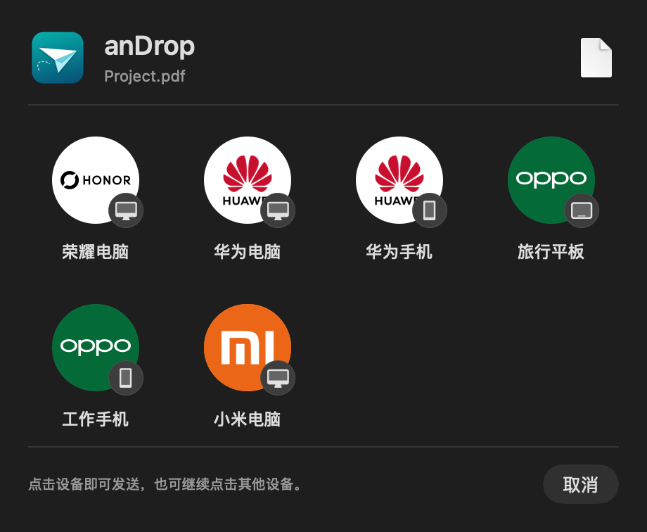
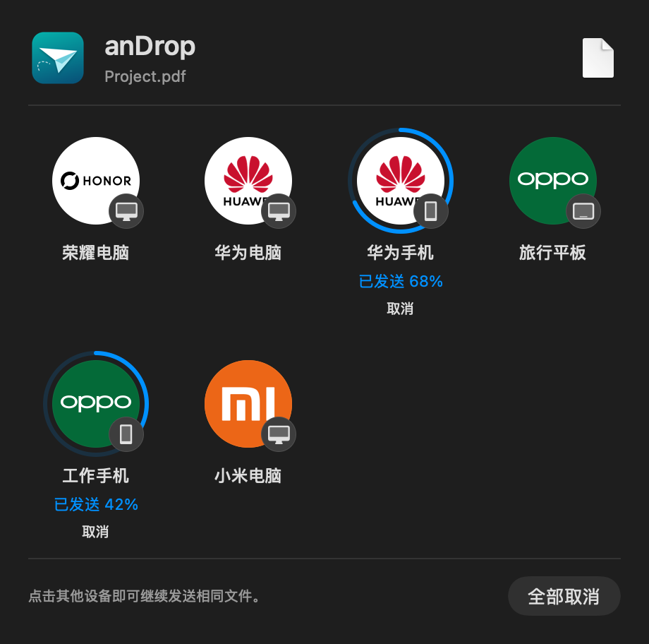
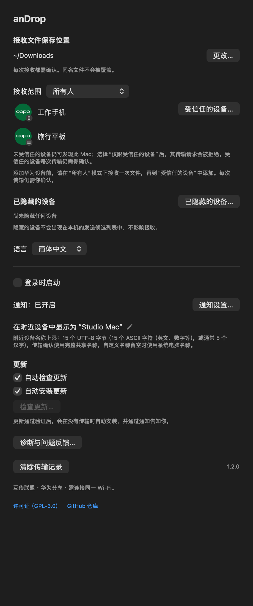
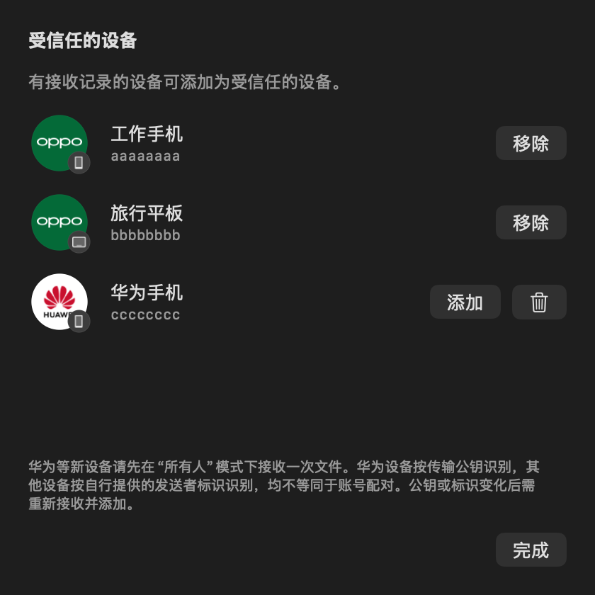

# anDrop

**用手机、平板自带的互传，在它们与 Mac 之间收发文件。**

简体中文 · [English](README.en.md)

[](https://github.com/TakeruF/cn-android-share/releases/latest)

anDrop 是一个常驻 macOS 菜单栏的文件共享应用，正式支持 **互传联盟** 生态与 **华为分享**。无需提前连接厂商电脑端应用，也无需在手机上额外安装应用、登录账号或连接 USB。文件通过本地网络传输。**两台设备需要开启蓝牙，并连接到同一个 Wi-Fi（同一局域网）。**

**[下载 anDrop](https://github.com/TakeruF/cn-android-share/releases/latest)** · [使用与排查](docs/usage.md) · [兼容性记录](docs/compatibility.md)

**1.2.0：华为分享正式支持是本次更新的主打功能。** 可通过设备自带的华为分享与 Mac 双向收发文件；与鸿蒙星河互联同时运行仍属实验性支持。具体机型验证范围与传输限制见下方说明。

1.2.0 提供适用于 **Apple Silicon Mac、macOS 14 及以上**的 DMG 安装包。OPPO Find X9 Pro 和 OPPO Pad 4 Pro 均已进行包括双向传输在内的多场景实机测试；华为分享已在 **华为 Pura 70（鸿蒙 7）** 上完成双向传输验证。其他品牌和机型尚未实机验证。构建检查已确认随应用打包的二进制不要求高于 macOS 14 的版本，但尚未在 macOS 14 实机测试。下方图片均使用虚构数据，不代表其中所有品牌都已通过兼容性测试。

**1.2.0** 新增华为分享正式支持、向多台设备分别发送同一批文件、右键重命名／隐藏候选设备，以及自动安装更新与通知。照片接收兼容性与受信任设备管理同步改进。详见[更新说明](docs/releases/1.2.0.md)和[测试记录](docs/testing.md)。从 1.0.0 升级时，旧版信任记录需成功接收一次文件后重新添加，参见 [1.1.0 升级说明](docs/releases/1.1.0.md)。

## 安装与首次使用

1. 从上方链接下载 `.dmg`，打开后将 **anDrop** 拖入 **Applications（应用程序）**。
2. 打开 anDrop，按提示允许蓝牙、本地网络、通知及保存文件夹访问。菜单栏会出现纸飞机图标。
3. 手机或平板开启互传，Mac 与对方设备连接同一 Wi-Fi，即可开始收发。访客网络或开启设备隔离的网络可能无法传输。

**建议使用 anDrop 前退出鸿蒙星河互联。** anDrop 已可独立通过华为分享收发文件，可替代鸿蒙星河互联的文件共享功能，无需同时运行。共存仍属实验性支持，可能影响设备发现或传输；退出前请先完成该应用中的传输。若检测到鸿蒙星河互联正在运行且 anDrop 发送或接收失败，anDrop 会弹窗建议退出后重试。

首次安装默认使用**简体中文**，可在设置中切换英语或跟随系统。anDrop 运行时即可接收，退出应用即可停止。平时无需保留主窗口，Dock 图标也会隐藏；与鸿蒙星河互联同时运行时会保留 Dock 图标，以改善蓝牙发现。

## 看看它怎么用

这些画面由实际应用界面生成，设备名称、文件名、电脑名称和进度均为演示数据，不包含真实账号、设备记录或传输内容。

### Mac → 手机／平板

在接收设备开启互传，并允许附近设备发现。必要时临时选择“所有人”；部分系统会在几分钟后自动关闭这一状态。

在 Finder 中选中文件，点击 **共享 → anDrop**，或从 anDrop 菜单栏选择“发送文件”。圆形厂商标志旁的角标区分手机、平板和电脑；点击设备即可立即发送，并在对方确认接收。其他设备仍可点击：发送中也能继续点击另一台设备，向其发送相同文件。右键点击设备图标，可选择“重命名设备…”或“从候选设备中隐藏”。名称仅保存在此 Mac；在设置 →“已隐藏的设备…”中可随时恢复显示。



发送时，圆环和百分比显示进度；准备、等待接收和连接阶段会显示对应状态。收到对方的完成确认后才显示“已发送”。发送中点击其他窗口，anDrop 会退到后面，传输继续。



每台设备分别显示发送进度，可单独取消或重试；“全部取消”停止所有正在发送的任务和等待中的重试。发送前“取消”收起窗口，全部发送成功后点击窗口外即可收起。

### 手机／平板 → Mac

1. 在设备中选中文件，打开自带的兼容互传功能，选择 Mac。
2. 在 anDrop 的通知或菜单栏中确认接收。**每次接收都需要确认。**
3. 文件直接保存在 Mac 的“下载”文件夹中。同名文件会添加序号，不会覆盖已有文件，也不会自动打开。

可同时向不同设备发送；接收时不同时进行其他传输。文件夹请先压缩；同一批中具有相同文件名的文件请分开发送。

### 按自己的习惯设置

菜单栏提供发送文件、查看传输进度、最近记录和设置。设置中可更改接收文件夹、共享名称、语言、登录时启动、接收范围和更新选项；底部也可打开许可证和 GitHub 仓库。

<details>
<summary>查看设置画面（演示数据）</summary>



</details>

## 接收范围与受信任的设备

菜单栏和设置均可选择 **仅限受信任的设备（Trusted Devices Only）** 或 **所有人（Everyone）**。两种模式下，每次接收都需要确认，不会自动接收文件。

**这与 AirDrop 的“仅限联系人”不同：未受信任的设备仍可能看到此 Mac；“仅限受信任的设备”会拒绝它们的传输请求，不会向它们隐藏 anDrop。** 详见[发现限制与接收过滤](docs/trusted-discovery.md)。

打开设置 → **受信任的设备…**，即可从成功接收文件的记录添加设备，即使设备当前不在线。新设备请先在“所有人”模式下向 Mac 发送一次文件。列表会显示厂商标志、手机／平板角标及设备名称；设备重名时会显示不同的本机识别码后缀。可随时移除信任或忘记设备。



此功能保存协议发送者 ID 的摘要，蓝牙地址轮换不会影响已登记的 ID。它不按账号或名称判断，也不是加密配对或经认证的设备身份。控制连接取得 ID 后，未登记设备会在显示接收确认和下载文件前被拒绝。已登记设备每次仍需确认；移除信任不会中断已经接受的传输。旧版 UUID 记录需在“所有人”模式下重新接收一次文件，再添加新记录；无法安全地仅凭同名自动迁移。

华为设备也可添加：更新后先在“所有人”模式下接收一次文件，再到此列表添加。华为记录保存传输公钥的 SHA-256 摘要，并在每次接收时检查对方持有对应的私钥；不按名称、IP 或发现广播识别。这是本机信任登记，不是华为账号配对。公钥变化后需重新接收并添加；旧的华为接收记录不含公钥，无法自动迁移。

## 自动更新

**自动检查更新和自动安装更新默认开启。** anDrop 启动时检查，之后定期检查 GitHub Releases；更新通过签名验证并下载完成后，会自动安装并重启，同时通过通知告知你已更新到哪个版本。传输期间会推迟检查或重启，避免中断文件传输。关闭自动安装后，有新版本时会通过通知提醒你。

可在设置 →“更新”中关闭自动检查或自动安装；也可从菜单栏手动“检查更新…”。更新检查与下载需要连接 GitHub，文件共享本身不使用云服务。

## 常见问题

| 遇到的情况 | 可以怎么做 |
| --- | --- |
| Finder 的共享菜单里没有 anDrop | 先打开一次 anDrop，再在 macOS 设置中启用它的共享扩展；也可从菜单栏发送文件。 |
| Mac 找不到手机／平板 | 解锁对方设备，重新开启互传及“所有人可发现”，确认已连接同一 Wi-Fi。部分设备的公开状态会自动到期。 |
| 设备已关闭可发现，列表里还有它 | 正常情况下，收到最后一次蓝牙广播后约 10–11 秒会移除；Mac 无法读取对方系统的公开倒计时。 |
| 两台设备显示同一个人的名字 | 共享名称可能来自账号。用手机／平板角标区分，右键点击设备图标设置本地名称或隐藏候选；完全重名时先只公开一台再命名。 |
| 没弹出通知 | 检查 macOS 通知和专注模式；接收确认及进度仍可从菜单栏查看。 |
| 鸿蒙星河互联同时运行时，发现或收发失败 | 建议先完成鸿蒙星河互联中的传输，退出该应用后重试；anDrop 可独立完成华为分享文件收发。共存仍属实验性支持。 |
| Finder 共享菜单仍显示旧图标 | 系统可能保留旧扩展图标缓存，可稍后重启 Mac。此问题不影响文件传输。 |

名称与隐私：设备的本地别名最多 **40 个字符**，不会修改手机或账号名称。Mac 的共享名称默认来自系统电脑名称，可在设置中点击名称旁的铅笔修改，留空恢复默认。附近广播名称最多 **15 个 UTF-8 字节**（通常 15 个 ASCII 字符，约 5 个汉字），传输确认使用完整共享名称。附近设备可以看到广播名称。传输记录仅保存在本机，可在设置中清除。鸿蒙星河互联运行时，附近名称暂用 `A`。

## 日志与问题反馈

传输失败时，点击通知中的**“查看日志”**，或在设置中打开**“诊断与问题反馈…”**。可以预览日志、在访达中找到文件，或点击**“向开发者报告问题…”**，生成发给 `support@takeruf.com` 的邮件草稿并附上日志。补充复现步骤、对方设备型号与系统版本后，检查内容并自行发送；anDrop 不会自动发送报告。无法打开邮件时，可手动附加日志。

诊断报告包含传输阶段、错误代码、文件类型与数量、设备厂商与类型、Mac／anDrop 版本，以及传输开始和失败时 Mac 上运行的应用名称与标识。不包含文件名、文件内容、设备名称、网络地址或密钥。日志仅保存在本机，保留最近 300 条事件、20 次失败快照和 10 份导出报告；旧版或较早的失败可能没有详细日志。开发者可参阅[诊断字段与限制](docs/diagnostics.md)。

## 哪些设备可以用？

互传联盟是小米、荣耀、OPPO、vivo 等厂商参与的跨品牌共享体系，**并非 Android 通用标准，也不同于 Google Quick Share**。参见[荣耀官方介绍](https://www.honor.com/cn/support/content/zh-cn15883773/)。兼容性取决于机型、地区及系统版本；联盟成员或显示了厂商标志，都不代表已通过 anDrop 测试。

| 已检查的项目 | 当前结果 |
| --- | --- |
| OPPO Find X9 Pro | 已进行包括同一 Wi-Fi 下双向传输在内的多场景实机测试，并检查了传输文件的哈希。 |
| OPPO Pad 4 Pro | 已进行包括设备发现、平板类型显示及同一 Wi-Fi 下双向传输在内的多场景实机测试。 |
| 荣耀 | 支持华为分享与安卓互传的荣耀机型是下一步实机确认与验证的重点，计划分别测试两种分享方式的设备发现与双向文件传输。具体支持情况取决于机型和系统版本，尚未实机验证。 |
| 小米、vivo 等其他品牌／机型 | 目标生态中的兼容设备，尚未实机验证。 |
| Apple Silicon Mac，macOS 27.0.1 | 已验证的开发环境；发行包面向 macOS 14 及以上。macOS 14 实机、Intel 均未验证，1.2.0 不提供 Intel 安装包。 |
| 鸿蒙星河互联共存 | 实验性支持；建议完成该应用中的传输后退出，改用 anDrop 收发文件，避免发现或传输冲突。 |
| 华为分享 | **anDrop 已正式支持同一局域网内的华为分享。测试设备：华为 Pura 70，鸿蒙 7。** 已通过本体双向 3 文件传输、Downloads 保存、同名再接收及内容一致验证。手机亮屏时无需打开分享页即可发现；首次传输需手机选择“所有人可见”，之后“仅分享过的设备可见”也可发送；传输中取消或断开后可直接重传。最新完整构建已通过含空文件、日文名及 8 MiB 的双向传输、Downloads 保存和同名再接收验证。手机身份认证、息屏发现及 Wi-Fi 断开恢复仍待验证。见[调查记录](docs/huawei-share-research.md)。 |
| Wi-Fi Direct、Google Quick Share | 尚未实现。 |

上述收发测试结果来自开发阶段，不代表每次界面或打包调整后都重新进行了实机传输。完整记录见[兼容性表](docs/compatibility.md)与[测试报告](docs/testing.md)。品牌和设备类型识别不等于精确机型识别。

当前源码中，Mac → 华为的发送上限为 16 个文件、单个 4 GiB、合计 16 GiB，使用磁盘快照和分块加密发送。64 MiB 已通过本机套接字的完整性与内存用量测试；GiB 级实机传输尚未验证。华为 → Mac 的接收上限仍为单个 16 MiB、合计 16 MiB。

## 从源码构建

普通用户可直接下载 DMG；下面的步骤适合开发者。需要 Xcode 26 或更新版本、Swift 6.2+ 和 Python 3.14。**请使用面向旧版 macOS 构建的 Python 与依赖**（如 Python 官网的 macOS 安装包）；本机 Homebrew 的 Python 可能要求更新的 macOS。构建会检查应用内所有 Mach-O 二进制的最低版本，不会仅修改声明来假装兼容。

```sh
python3.14 -m venv .venv
.venv/bin/python -m pip install --only-binary=:all: -r requirements.txt
.venv/bin/python build.py
```

输出为 `build/anDrop.app`。默认使用临时签名；正式发行包使用 Developer ID 签名。构建会下载并校验固定版本的 Sparkle。详见[构建、签名与发行](docs/building.md)。无需关闭 macOS 安全功能。

<details>
<summary>开发者：测试、原理和图片生成</summary>

```sh
.venv/bin/python -m unittest discover -s tests -v
swift test
python3 scripts/render-docs.py
```

- [架构与协议边界](docs/architecture.md)
- [详细使用与排查](docs/usage.md)
- [设备识别调查](docs/device-identification.md)
- [演示图片生成说明](docs/images/README.md)
- [已归档的接收面板原型](Prototypes/ReceivePanel/README.md)：保留原控制中心面板的源码和预览，供将来复用；不包含在发行版中。

技术文档目前主要为英文。仓库名是 **cn-android-share**，应用名是 **anDrop**。

</details>

## 许可证与项目关系

本项目原创源代码、文档和应用图标使用 **GPL-3.0-only**。第三方组件保留各自许可证；[官方厂商标志](Resources/BrandLogos/README.md)的版权和商标权归各自所有者，不属于本项目的 GPL 授权范围，文档画面中的品牌标志也不例外。参见 [LICENSE](LICENSE)、[NOTICE.md](NOTICE.md) 和[许可证说明](docs/licensing.md)。

本项目未获设备厂商或 Apple 官方认证或背书。演示图片仅使用虚构数据；真实设备日志、私人截图、厂商 APK、反编译厂商源码、凭据和私钥不包含在仓库中。Developer ID 签名证书可被检查，其中包含签名者身份；源码使用匿名贡献者信息不会隐藏证书中的身份。
