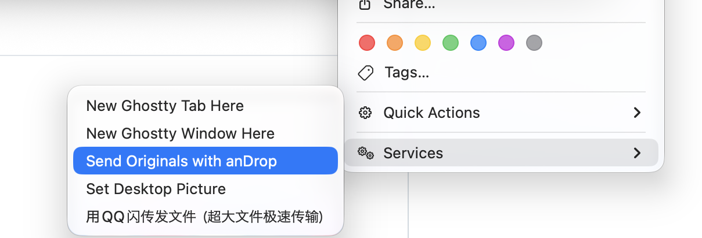

# anDrop 1.3.7

[简体中文](https://github.com/TakeruF/androp/blob/v1.3.7/docs/releases/1.3.7.md) · English

- Add the Finder service **Send Originals with anDrop**. Select one or more files, right-click, choose Services → Send Originals with anDrop, then choose a recipient.
- Send original files directly, preserving their existing embedded capture dates, location and other metadata. Batches, additional recipients and retries keep this policy. Paired images and videos are sent separately without Live Photo format conversion.
- The service name supports Simplified Chinese and English. The screenshot below shows the actual menu on an English system.

Finder may still convert photos before ordinary Share → anDrop receives them. For originals, use the service above or choose Options → Format → Current in the Share panel. Metadata absent from the original file is not added; gallery display and indexing depend on the receiving device.

Build 13700 passes 325 Python tests, 55 Swift tests and the production AppModel regression. The actual Finder service handed 11 HEIC files to one recipient chooser, and a local TLS/ZIP transfer verified all 11 files byte for byte. Physical OPPO receipt and gallery indexing were not reverified for this change.

Check for updates in anDrop Settings, or download **anDrop-1.3.7-arm64.dmg** and replace anDrop in Applications. Requires an Apple Silicon Mac running macOS 14 or later.
