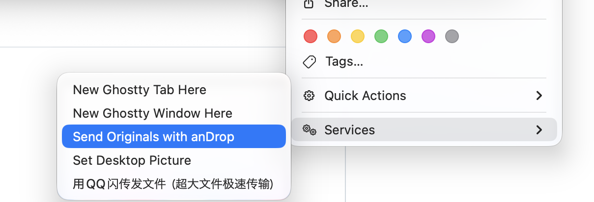

# anDrop 1.3.7

简体中文 · [English](https://github.com/TakeruF/androp/blob/v1.3.7/docs/releases/1.3.7.en.md)

- 新增访达服务 **“通过 anDrop 发送原始文件”**：选择一个或多个文件，右键选择“服务”，再选择此项并指定接收设备。
- 直接发送原始文件，保留文件内已有的拍摄日期、位置等元数据。批量发送、追加接收设备与重试均保持此方式；配对照片和视频分别发送，不进行实况照片格式转换。
- 服务名称支持简体中文和英文。下图为英文系统中的实际菜单。

普通“共享 → anDrop”仍可能由访达先转换照片格式；需要原始文件时，使用以上服务入口，或在共享面板选择“选项 → 格式 → 当前”。原始文件本身没有的元数据不会补写，对方相册的显示与索引方式取决于接收设备。

构建编号为 13700。325 项 Python 测试、55 项 Swift 测试及正式 AppModel 回归测试通过。实际访达服务已将 11 张 HEIC 一次交给接收设备选择窗口；本地 TLS/ZIP 传输确认这 11 个文件逐字节一致。该检查未重新进行 OPPO 实机接收或相册索引验证。

在 anDrop 设置中检查更新，或下载 **anDrop-1.3.7-arm64.dmg**，替换“应用程序”中的 anDrop。需要 Apple Silicon Mac 和 macOS 14 或以上。
